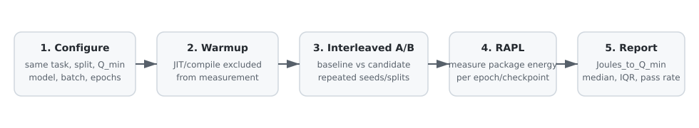

# energy-to-quality

[](https://github.com/kolrmdo-cmyk/energy-to-quality/actions/workflows/smoke.yml)
[](LICENSE)
[](pyproject.toml)
[](METHODOLOGY.md)

**Measure training energy to target quality — not just accuracy.**

[Русская версия](README.ru.md)

`energy-to-quality` is a small reproducible benchmark for CPU training runs.  
Main metric: **`Joules_to_Q_min`** — how many joules it takes to reach a target quality threshold `Q_min`.

> Honest prototype. Results are tied to the tested hardware/task/protocol, not a universal physical minimum.



## Why it matters

Accuracy alone does not answer a practical question: *how much energy did it cost to get good enough?*

This repo provides a simple, auditable protocol:

- **Honest oracle:** Intel RAPL package-0 (`/sys/class/powercap/intel-rapl:0/energy_uj`)
- **Honest comparison:** JIT/warmup excluded, interleaved A/B runs, repeated seeds, median/IQR/pass rate, paired diffs
- **Reproducible artifacts:** scripts + JSON outputs

## Key results (Intel CPU, MNIST/MLP)

| Experiment | Task | Comparison | Result | Takeaway |
|---|---|---|---|---|
| v29 | MNIST 12k, Q=0.94 | one-cycle champion, 2 splits | 29.57 J [27.64,32.47] and 33.61 J [32.50,33.86], 5/5 + 5/5 | Confirmed champion on 2 splits |
| v34 | Full MNIST, Q=0.95 | one-cycle config | 263.69 J [198.80,320.36], 5/5 (same split, different seeds) | Reaches Q=0.95 reliably in that setup |
| v37 | Full MNIST, Q=0.95 | const_lr vs one-cycle, 10 paired runs | const 765.98 J [722.95,827.68], one 656.13 J [636.49,715.80], one better in 8/10 | Strong signal; loaded system |
| v37b | Full MNIST, Q=0.95 | const_lr vs one-cycle, 20 paired runs | const 267.70 J [242.25,592.77], one 240.23 J [209.93,433.22], one better in 13/20 | Direction holds; IQR overlap, background drift |

**Plain summary:** the simple one-cycle recipe usually reached target quality with less package energy than constant LR in these tests, but package-level RAPL includes background noise, so this is strong practical evidence, not an isolated lab-grade physical proof.

## Quick verify

Requirements: Linux, Intel CPU with RAPL package-0, Python 3.10+, read access to `energy_uj`.

```bash
# Champion run (full MNIST, Q=0.95)
uv run --with numpy --with scikit-learn --with numba -- \
  python scripts/run_champion.py --task mnist-full --q-min 0.95 --repeats 5 --out results/verify_champion.json

# Honest A/B proof (const_lr vs one-cycle)
uv run --with numpy --with scikit-learn --with numba -- \
  python scripts/run_proof.py --repeats 10 --out results/verify_proof.json
```

What to inspect in `verify_proof.json`:

- `summary.const_lr.q0.95` / `summary.onecycle.q0.95` — pass rate, median_J, IQR
- `paired.0.95` — pairwise diffs and win counts
- `system_before/after`, `idle_power_before/after` — run conditions

## Example output

```json
{
  "summary": {
    "const_lr": {
      "q0.95": { "pass_rate": 1.0, "n_pass": 20, "median_J": 267.70, "iqr_J": [242.25, 592.77] }
    },
    "onecycle": {
      "q0.95": { "pass_rate": 1.0, "n_pass": 20, "median_J": 240.23, "iqr_J": [209.93, 433.22] }
    }
  },
  "paired": {
    "0.95": { "median_diff_a_minus_b_J": 36.71, "a_better_count": 7, "b_better_count": 13, "median_ratio_a_over_b": 1.15 }
  }
}
```

*Snippet from v37b (20 interleaved repeats, same fixed full-MNIST split, different training seeds).*

## What's in the repo

```text
.
├── assets/protocol.svg      # protocol diagram
├── scripts/
│   ├── run_champion.py      # reproducible champion config
│   └── run_proof.py         # interleaved A/B proof with checkpoints
├── results/                 # saved JSON artifacts
├── ONE_PAGER.md             # short presentation-ready summary
├── METHODOLOGY.md           # measurement protocol
├── RESULTS.md               # detailed results and caveats
└── README.md
```

## Limitations (read this)

- **RAPL package-0 measures whole CPU package**, not only training. Background load affects absolute joules.
- **Scope is limited:** Intel CPU + MNIST/MLP proof-of-protocol. No automatic transfer to GPU/TPU/LLMs.
- **Not a breakthrough claim:** this is a practical measurement recipe, not a new learning theory or physical minimum.
- **IQR overlap exists** in some comparisons; interpret with paired stats and run conditions.

## Next good steps

- Port the same protocol to GPU (NVML) or external power meter.
- Test on more representative workloads (CIFAR, small transformer, fine-tuning).
- Wrap as CI energy-regression check: `Joules_to_Q_min` A/B gate.

## Contributing

See [CONTRIBUTING.md](CONTRIBUTING.md). Issues and reproducibility reports are welcome.

## License

MIT — see [LICENSE](LICENSE).
