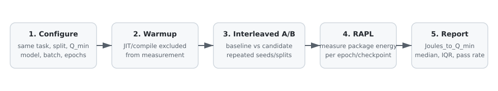

# energy-to-quality

[](https://github.com/kolrmdo-cmyk/energy-to-quality/actions/workflows/smoke.yml)
[](LICENSE)
[](pyproject.toml)
[](METHODOLOGY.md)

**Измеряем энергию обучения до целевого качества — а не только accuracy.**

[English version](README.md)

`energy-to-quality` — небольшой воспроизводимый бенчмарк для прогонов обучения на CPU.  
Главная метрика: **`Joules_to_Q_min`** — сколько джоулей нужно, чтобы достичь порога качества `Q_min`.

> Честный прототип. Результаты привязаны к железу/задаче/протоколу и не являются универсальным физическим минимумом.



## Зачем это нужно

Accuracy сама по себе не отвечает на практический вопрос: *сколько энергии стоило достичь нужного качества?*

Репозиторий даёт простой и проверяемый протокол:

- **Честный оракул:** Intel RAPL package-0 (`/sys/class/powercap/intel-rapl:0/energy_uj`)
- **Честное сравнение:** JIT/warmup вне замера, чередование A/B, повторы, медиана/IQR/pass_rate, парные разницы
- **Воспроизводимые артефакты:** скрипты + JSON-результаты

## Ключевые результаты (Intel CPU, MNIST/MLP)

| Эксперимент | Задача | Сравнение | Результат | Вывод |
|---|---|---|---|---|
| v29 | MNIST 12k, Q=0.94 | чемпион one-cycle, 2 split | 29.57 J [27.64,32.47] и 33.61 J [32.50,33.86], 5/5 + 5/5 | Чемпион подтверждён на 2 split |
| v34 | Full MNIST, Q=0.95 | конфиг one-cycle | 263.69 J [198.80,320.36], 5/5 (один split, разные seed) | Надёжно достигает Q0.95 в этом сетапе |
| v37 | Full MNIST, Q=0.95 | const_lr vs one-cycle, 10 пар | const 765.98 J [722.95,827.68], one 656.13 J [636.49,715.80], one лучше в 8/10 | Сильный сигнал; система была нагружена |
| v37b | Full MNIST, Q=0.95 | const_lr vs one-cycle, 20 пар | const 267.70 J [242.25,592.77], one 240.23 J [209.93,433.22], one лучше в 13/20 | Направление сохраняется; IQR перекрываются, фон дрейфует |

**Простыми словами:** простой рецепт с one-cycle обычно доходил до нужного качества с меньшей энергией пакета, чем const_lr, но RAPL package-0 включает фон системы. Это сильное практическое свидетельство, но не изолированное лабораторное доказательство.

## Быстрая проверка

Требования: Linux, Intel CPU с RAPL package-0, Python 3.10+, доступ на чтение `energy_uj`.

```bash
# Чемпион (full MNIST, Q=0.95)
uv run --with numpy --with scikit-learn --with numba -- \
  python scripts/run_champion.py --task mnist-full --q-min 0.95 --repeats 5 --out results/verify_champion.json

# Честное A/B сравнение (const_lr vs one-cycle)
uv run --with numpy --with scikit-learn --with numba -- \
  python scripts/run_proof.py --repeats 10 --out results/verify_proof.json
```

Что смотреть в `verify_proof.json`:

- `summary.const_lr.q0.95` / `summary.onecycle.q0.95` — pass_rate, median_J, IQR
- `paired.0.95` — парные разницы и число побед
- `system_before/after`, `idle_power_before/after` — условия прогона

## Пример вывода

```json
{
  "summary": {
    "const_lr": {
      "q0.95": { "pass_rate": 1.0, "n_pass": 20, "median_J": 267.70, "iqr_J": [242.25, 592.77] }
    },
    "onecycle": {
      "q0.95": { "pass_rate": 1.0, "n_pass": 20, "median_J": 240.23, "iqr_J": [209.93, 433.22] }
    }
  },
  "paired": {
    "0.95": { "median_diff_a_minus_b_J": 36.71, "a_better_count": 7, "b_better_count": 13, "median_ratio_a_over_b": 1.15 }
  }
}
```

*Фрагмент из v37b (20 interleaved повторов, тот же фиксированный split full MNIST, разные seed обучения).*

## Ограничения

- **RAPL package-0 меряет весь пакет CPU**, не только обучение. Фон влияет на абсолютные джоули.
- **Ограниченный scope:** Intel CPU + MNIST/MLP. Автоматического переноса на GPU/TPU/LLM нет.
- **Не прорыв:** это практический рецепт измерения, не новая теория обучения и не физический минимум.
- **IQR перекрываются** в части сравнений; смотреть вместе с парной статистикой и условиями прогона.

## Лицензия

MIT — см. [LICENSE](LICENSE).
